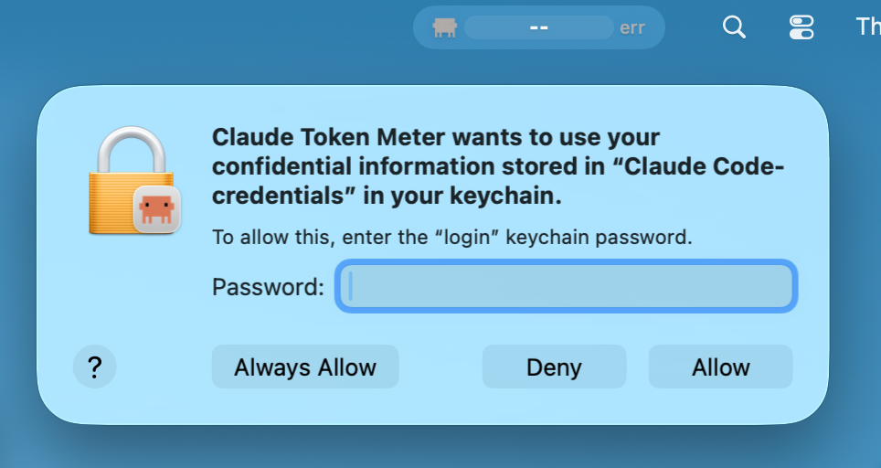

<h1 align="center">Agent Token Monitor</h1>

<p align="center">
  <a href="./LICENSE">
    
  </a>
  <br/>
Monitor your Claude, Codex, and Cursor subs with a lightweight macOS taskbar item.
</p>

<p align="center">

</p>

## Install

**Option 1: Download from Releases**

Install the `.dmg` from [Releases](https://github.com/pi0neerpat/claude-token-meter/releases)

**Option 2: Build Locally**

```bash
./build.sh
```

You'll need to grant the app permission to access your Claude Oauth token. 



For Codex, the app reads `~/.codex/auth.json` directly (or `$CODEX_HOME/auth.json`). If yours lives somewhere else, use **Enable Codex…** in the Codex menu to point the app at it.

> **Why isn't the app sandboxed?** On Macs low on disk space, macOS force-quits sandboxed menu-bar apps while it frees up storage, so a sandboxed version would quit without warning every few minutes. The app reads local credentials and account metadata, then retrieves usage from the Claude, Codex, and Cursor services; Codex may use your installed CLI as a fallback.

## Usage

Click the menu bar icon to see your usage. The icon color shows your status:
- **Orange** — comfortable
- **Yellow** — getting close
- **Red** — approaching limit


